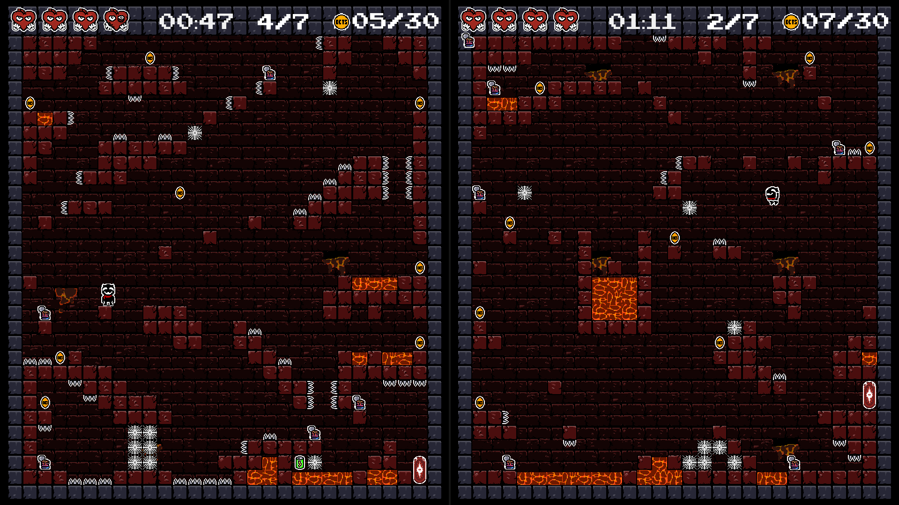

# ECTS-catchers

Embark on a fun split-screen platformer adventure where your goal is to collect all 30 ECTS coins to unlock the next level. Each level represents a semester of your Bachelor's degree—can you earn them all and graduate? The deeper you go, the darker it gets.


## Screenshots




## Features

- Collectible coins
- Split-screen for 2 players
- Powerups
- Soundtrack


## Run Locally

Clone the project

```bash
  git clone https://github.com/neyluu/ECTS-catchers.git
```

Go to the project directory

```bash
  cd ECTS-catchers
```

Install dependencies. Python 3.12 or newer is needed (may work on older versions but it`s not tested)

```bash
    pip install -r requirements.txt
```

Start the game

```bash
  python main.py
```


## Tech Stack

Python 3.12 + pygame 2.6.1